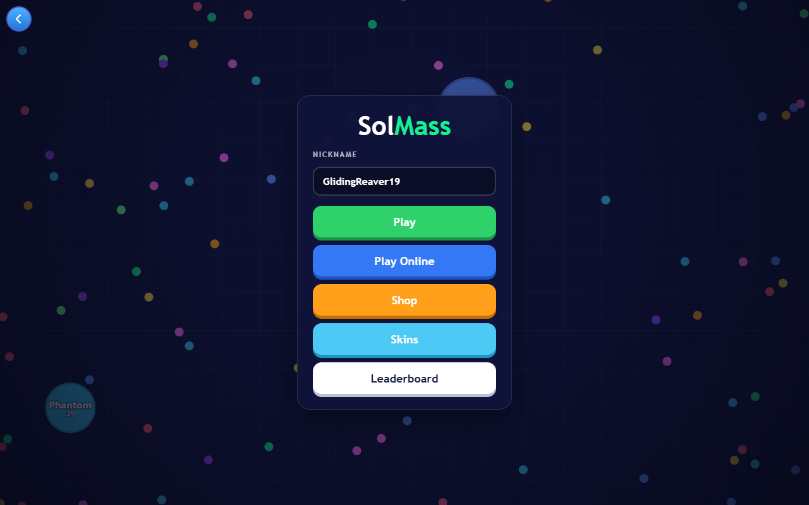
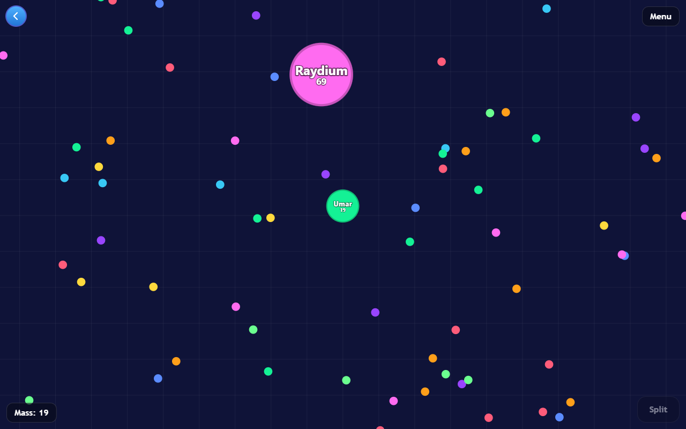
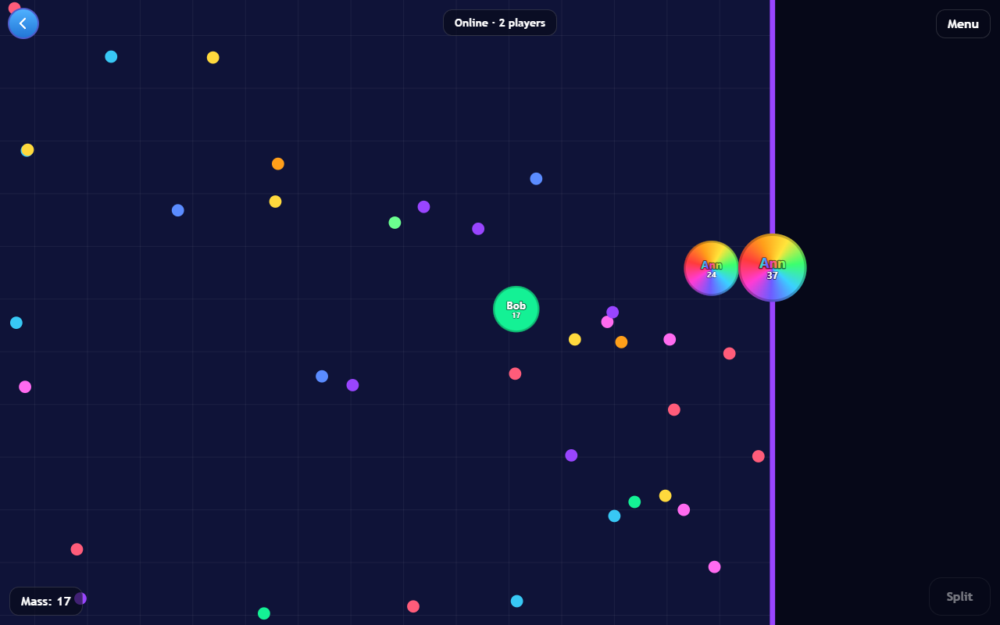
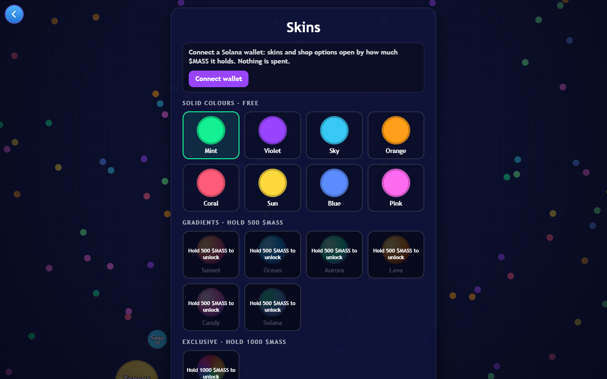
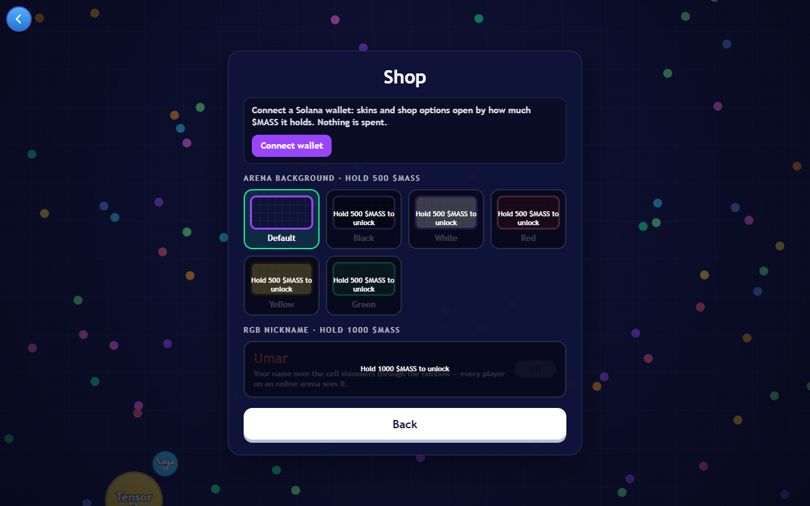

# SolMass

[](https://jnfmh60i.idos.games/)
[](https://solana.com)
[](https://idosgames.com)
[](https://colosseum.com)

> A competitive Web3 arena game inspired by Agar.io. Eat, grow, split and climb a global leaderboard — on a zero-inflation **Hold-to-Play** economy: nothing is minted, nothing is spent, and holding **$MASS** in a Solana wallet unlocks the premium looks.

[Live Demo](https://jnfmh60i.idos.games/) · [Game page on iDos Games](https://idosgames.com/app/JNFMH60I/) · [Docs](docs/) · Video Walkthrough _(to be added)_

---



---

## Hackathon Submission

Built for the Colosseum Solana hackathon on the [iDos Games](https://idosgames.com) platform.

| Name | Role | Contact |
|------|------|---------|
| Umar | Creator | [GitHub](https://github.com/duckalis) |

---

## Problem and Solution

### 1. Play-to-earn inflation
- **Problem:** Web3 games pay players in freshly minted tokens. Emission outruns demand, the price slides, and the economy collapses.
- **SolMass:** Zero inflation. The game mints nothing and pays out nothing. $MASS has a fixed supply of 1,000,000,000 and its mint authority is revoked on-chain, so nobody — the game included — can create more.

### 2. Utility that means spending
- **Problem:** When a token is only useful when it is spent, every use of the game is a sale waiting to happen.
- **SolMass:** Hold-to-Play. Utility comes from holding: a wallet with 500 $MASS or more unlocks six gradient skins and five arena backgrounds, 1,000 or more unlocks the exclusive Rainbow skin and an animated RGB nickname that every player on an online arena sees. The tokens never leave the wallet. Sell them and the looks lock again; buy back and the saved picks return.

### 3. Heavy onboarding
- **Problem:** Wallet pop-ups, approvals, gas and bridges stand between a new player and the first minute of play.
- **SolMass:** It opens in a browser tab. Sign in with a Solana wallet — one signed message, no transaction, no fee — or with an iDos Games or e-mail account. The whole game is free to play, and it only ever *reads* a balance: it never asks for a transaction or a token approval.

### 4. Gameplay as an afterthought
- **Problem:** The "earn" loop becomes the game, and the game itself becomes a chore.
- **SolMass:** An arcade game first: an offline arena against bots, one-press online multiplayer, splitting, a global leaderboard. The token changes how a player looks, never how strong they are — there is nothing to pay to win.

More on the economy: [docs/product.md](docs/product.md)

---

## Why Solana

- **The wallet is the account** — signing in is one signed message in the wallet the browser already has (Phantom, Solflare, Backpack): no password, no transaction, no fee
- **A holding is one cheap read** — an SPL balance sits in an associated token account whose address the game derives in the browser, then checks with a single read-only `getAccountInfo` call; no indexer, no backend, no transaction
- **Scarcity anyone can verify** — a mint whose authority is `null` is an on-chain fact, so "zero inflation" does not rest on a promise: [$MASS on Solscan](https://solscan.io/token/FJX66t2J9WyZNtSYPHJBRFcScytZLFa84h8yQzFiidos)
- **Low cost of entry** — negligible fees make it realistic for a casual player to buy and hold a few hundred tokens for a cosmetic
- **Launch next to the game** — the token and its bonding curve live on the iDos Games launchpad on Solana, on the same page as the game

---

## Summary of Features

- **Offline arena with smart bots** — 14 bots that graze, hunt the player when they are bigger and run when they are smaller
- **Online multiplayer** — "Play Online" puts the player on a shared arena for up to 12 people in one press; the arena survives its host leaving
- **Mass absorption** — food and smaller cells add mass; the heavier the cell, the bigger and slower it is; a cell is swallowed once about 80% of it is inside a bigger one
- **Split** — above 40 mass, Space (or the on-screen button) shoots half of the cell toward the cursor; the halves merge back after 30 seconds
- **Global leaderboard** — the final mass of every round goes to an all-time top 100
- **Solana wallet sign-in** and a strictly **read-only $MASS balance check** — no mint, no transfer, no approval
- **Hold-to-unlock Skins and Shop** — 8 free colours; 6 gradient skins and 5 arena backgrounds from 500 $MASS; the Rainbow skin and the RGB nickname from 1,000 $MASS; a locked item is dimmed and says "Hold 500 $MASS to unlock"
- **Picks saved in the player's profile**, so they follow the account to another device
- **Desktop and phone browsers** — mouse or finger

| Offline round | Online arena: Rainbow skin and RGB nickname |
|---|---|
|  |  |

| Skins | Shop |
|---|---|
|  |  |

Bots carry nicknames that nod to the Solana ecosystem; that is a joke, not an affiliation. The online screenshot was taken in a development build, which can preview a tier without the tokens.

---

## Tech Stack

| Layer | Technology |
|-------|-----------|
| Platform | iDos Games Host Shell (`@idosgames/app-shell`, `core`, `module-sdk`, `react`, `wallet`) |
| Frontend | React 19 · Vite 8 · TypeScript (strict) |
| Game | HTML5 Canvas 2D · own simulation, no game engine |
| Multiplayer | iDos Games rooms + WebRTC data channels · host-authoritative · binary protocol · host migration |
| Solana | Solana Web3.js and Reown AppKit (inside the iDos Games wallet stack) for wallet sign-in · read-only JSON-RPC for SPL balances |
| Backend | iDos Games title services: accounts, player profile, leaderboard, rooms and signaling |
| Hosting | iDos Games static hosting |

---

## Architecture

```
┌───────────────────────── Browser tab (React + Vite) ─────────────────────────┐
│  iDos Games host shell: sign-in, session, leaderboard screen                 │
│  ┌──────────────────────────── sol-mass module ───────────────────────────┐  │
│  │  components/   menu · HUD · Skins · Shop · Game Over         (React)   │  │
│  │  game/         world rules · bots · renderer             (Canvas 2D)   │  │
│  │  net/          quick match · binary protocol · host migration          │  │
│  │  web3/         token account address · balance read · hold tiers       │  │
│  └────────────────────────────────────────────────────────────────────────┘  │
└────────┬───────────────────────────┬──────────────────────────┬──────────────┘
         │ HTTPS                     │ WebRTC, peer to peer     │ JSON-RPC, read-only
         ▼                           ▼                          ▼
┌───────────────────┐      ┌───────────────────┐      ┌───────────────────────┐
│ iDos Games title  │      │ Other players     │      │ Solana mainnet RPC    │
│ accounts, profile │      │ one device hosts  │      │ getAccountInfo of the │
│ leaderboard       │      │ the arena, the    │      │ wallet's $MASS token  │
│ rooms, signaling  │      │ rest send cursors │      │ account               │
└───────────────────┘      └───────────────────┘      └───────────────────────┘
```

See [docs/architecture.md](docs/architecture.md) for the component breakdown.

---

## Quick Start

**Prerequisites:** Node.js 20.19+ or 22.12+, npm

```bash
# Clone the repository
git clone https://github.com/duckalis/SolMass-Colosseum
cd SolMass-Colosseum

# Install dependencies
npm install

# Start the game
npm run dev
```

Open http://localhost:5180. The dev server talks to the game's **sandbox**, not to the live game, and its sign-in screen has "Play as guest", so everything except the token tiers can be tried without a wallet.

| Input | Action |
|---|---|
| Mouse / finger | Steer the cell |
| Space / Split button | Split |
| Esc / Menu button | Back to the main menu |

```bash
npm run typecheck   # TypeScript, strict
npm run build       # production build in dist/
```

No environment file is needed. [.env.example](.env.example) lists the optional overrides: your own Solana RPC, a WalletConnect project id.

---

## Status and Limitations

SolMass is a hackathon MVP. Version 0.4.0 went live on 2026-10-12, and there are no player numbers to report yet.

- **Nobody holds a tier yet.** $MASS was created the same day; its bonding curve stood at 0% when this was written, so the 500 and 1,000 tiers have been exercised only in development builds.
- **Tiers are checked on the player's device.** That is enough for cosmetics; anything of value would need a server-side check first.
- **Online arenas have no server.** One player's device simulates the arena and the others connect to it peer to peer, so guests play with their ping to the host, and nothing stops a modified client. Leaderboard scores are submitted by the client too.
- **The default RPC reads one account.** Through the free public node the game sees only the wallet's associated token account; tokens kept in any other account of the wallet read as zero.
- **Wallet sign-in covers wallets in the browser.** QR and phone-wallet sign-in from a desktop page need a WalletConnect (Reown) project id, which is not configured yet. The sign-in and balance flow has been tested end to end with a scripted wallet that implements Phantom's interface; a pass with the real extensions is still to do.

---

## Roadmap

- [x] Offline arena with bots, mass absorption, Split
- [x] One-press online multiplayer with host migration
- [x] Global leaderboard
- [x] Solana wallet sign-in and read-only $MASS balance
- [x] Hold-to-unlock Skins and Shop
- [x] Live build on iDos Games
- [ ] WalletConnect sign-in: QR and phone wallets
- [ ] Server-validated leaderboard scores
- [ ] Authoritative arena server
- [ ] Server-side tier check
- [ ] More skins, arena themes and hold tiers

Full roadmap: [docs/roadmap.md](docs/roadmap.md)

---

## Resources

- [Live game](https://jnfmh60i.idos.games/)
- [Game page and $MASS on iDos Games](https://idosgames.com/app/JNFMH60I/)
- [$MASS on Solscan](https://solscan.io/token/FJX66t2J9WyZNtSYPHJBRFcScytZLFa84h8yQzFiidos) — mint `FJX66t2J9WyZNtSYPHJBRFcScytZLFa84h8yQzFiidos`
- [Engineering notes](docs/feature-history/) — the decisions and constraints the code does not show
- Project presentation — to be added
- Video demo — to be added
